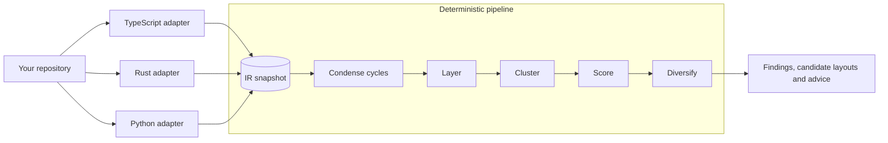

<div align="center">


# unlace

[](rust-toolchain.toml)
[](#-support-matrix)
[](LICENSE)

**Untangle your codebase** — see the knots in your module structure and the exact moves that undo them.

_A read-only analyzer for TypeScript, Rust and Python with cycle breaking, capacity checks, scored candidate layouts and confidence-graded move advice._

</div>

> 🔍 **Read-only by design.** unlace never writes to your source. Every command reads the repository and prints a report, so you can run it on any branch, as often as you like, and decide for yourself which moves to apply.

<br/>
<div align="center">

•&emsp;⚡ [Quick Start](#-quick-start)&emsp;•&emsp;📖 [Usage](#-usage)&emsp;•&emsp;🚦 [CI Gate](#-ci-gate)&emsp;•&emsp;📚 [CLI Reference](#-cli-reference)&emsp;•&emsp;⚙️ [Configuration](#️-configuration)&emsp;•

</div>
<br/>

---

## ⚡ Quick Start

Use **Rust 1.96 or newer** (pinned in `rust-toolchain.toml`) and a **C/C++ toolchain with CMake**, which builds the bundled [HiGHS](https://highs.dev/) solver. From a clone of this repository, install the `unlace` binary:

```bash
cargo install --path crates/cli
```

Then point it at any repository:

```bash
unlace analyze --root path/to/repo
```

On a small Python project with an import cycle, the report names the cycle and the cheapest import to cut:

```plain
Unlace report — cyclic
2 files · 2 symbols · 2 edges
All findings and moves are suggestions. Applying them may break the build; use your own judgement.

Structural findings
Shared findings (1)
  - cycle [violation] `alpha.py`/`beta.py` — 2-symbol cycle; unlace keeps a dependency cycle in
    one file; to split it, break `beta_step` -> `alpha_step` (w=1.0, exact)

Candidate layouts
anchored — 0 candidates (baseline -0.0750; search converged; current layout already optimal)
greenfield — 0 candidates (baseline 0.1250; search converged; current layout already optimal)

Advice
  None.
```

Prefer a build without installing? `cargo build --release` puts the binary at `target/release/unlace`.

---

## ✨ Why unlace?

### 😩 The Problem

Codebases rarely start tangled; they get there one reasonable import at a time:

- **Cycles creep in**: two modules that import each other quietly turn a layered design into one knot
- **Files outgrow their readers**: a module grows past the point where anyone reads it whole
- **Code drifts from its users**: helpers end up far from the code that calls them, and test-only code hides in production modules
- **Graphs show the problem, not the fix**: a dependency graph tells you something is wrong but not what to move where, and a wrong guess makes the knot tighter

### 💡 The Solution

unlace turns the whole graph into a plan:

- **🔗 Cycles broken**: finds every import cycle and names the cheapest dependency to cut, exactly for small cycles
- **📏 Sizes checked**: flags files and folders over configurable capacity caps
- **🗂️ Layouts proposed**: searches for cleaner, acyclic layouts and scores each against a structural objective
- **🧭 Moves explained**: lists every file and symbol move with before and after trees and the reason behind it
- **⚖️ Confidence graded**: separates recommended moves from review candidates, using two independent parameter profiles
- **🚦 CI-ready**: fails a build when selected structural violations appear

---

## 🚀 Key Features

| Feature                       | What it gives you                                                                                       |
| ----------------------------- | ------------------------------------------------------------------------------------------------------- |
| **Cycle breaking**            | Every dependency cycle, with the cheapest edge to cut; exact ILP for small cycles, a heuristic beyond   |
| **Capacity checks**           | Files over a production-line cap (600 by default) and over-full folders, domains and packages            |
| **Visibility and polarity**   | Over-wide visibility, production code that depends on tests, and production items only tests use        |
| **Candidate layouts**         | Scored before and after trees of the affected branches, with every proposed file and symbol move        |
| **Relocation advice**         | Recommended moves separated from review candidates, with the evidence and review reasons for each       |
| **Two parameter profiles**    | `anchored` respects the current layout, `greenfield` ignores it; agreement between them raises confidence |
| **Paired tests follow**       | A test file moves with the source it covers, so suggestions never split a source from its test          |
| **Package walls**             | Moves stay inside their package unless you opt in to cross-package moves                               |
| **Four output faces**         | Plain-text summary, Markdown report, JSON, and a violations table                                       |
| **Deterministic**             | Seeded search; parallelism never changes the result                                                     |

**Core Benefits:**

- **🔍 See the whole graph**: imports, references and calls across the repository in one analysis
- **🎯 Act with confidence**: every move carries its reason, its evidence and how many profiles agree
- **🛡️ Safe to run anywhere**: nothing is written to your source, ever
- **📊 Fits your pipeline**: JSON output and a gating exit code for CI

---

## 🧰 Support Matrix

| ✅ Supported | ⚠️ Partial (see note) | ❌ Unsupported |
| ------------ | --------------------- | -------------- |

| Capability                   | Support | Notes                                                                                   |
| ---------------------------- | ------- | --------------------------------------------------------------------------------------- |
| TypeScript and TSX           | ✅      | Imports, references, calls, and paired `.spec`/`.test` files                            |
| Rust                         | ✅      | Cargo workspaces, `#[cfg(test)]` modules, restricted visibility and trait impl blocks   |
| Python                       | ✅      | Imports, references, calls, and `test_*.py`/`*_test.py` pairs                           |
| Other languages              | ❌      | Files in other languages are not analyzed                                               |
| Exact cycle breaking         | ⚠️      | Exact ILP up to a configurable cycle size; larger cycles use a heuristic                |
| Applying moves automatically | ❌      | unlace only proposes moves; you apply them by hand or with your own tooling             |
| CI gating                    | ✅      | `unlace violations --fail-on` exits with code `2` on a match                            |
| Saved analysis JSON          | ⚠️      | Read only at the current result schema version; re-run `analyze` after upgrading        |

---

## 💡 Core Concept

unlace never reads source code in its engine. Per-language **adapters** parse the repository into a language-neutral **IR snapshot** of files, symbols and their dependency edges. A pure, deterministic **pipeline** then works only on that snapshot: it condenses cycles, layers the graph, clusters symbols into files and folders, scores each layout, and keeps a diverse set of candidates.



Each analysis runs two complete **parameter profiles** over the same snapshot. `anchored` rewards keeping files near their current paths; `greenfield` scores the layout as if starting fresh. Their built-in defaults differ only in that greenfield sets the `path` and `anchor` weights to `0.0`. A move both profiles support, with enough evidence, becomes **Recommended**; anything weaker stays a **Review candidate**.

See [docs/architecture/overview.md](docs/architecture/overview.md) for the crate layout, the eleven-phase pipeline, the IR snapshot contract and how the profiles differ.

---

## 📖 Usage

### Analyze a Repository

Run the full decomposition pipeline against any repository by pointing `--root` at it. This prints the same plain-text analysis report (violations + restructure candidates) on a terminal, in a pipe, or when redirected. Use `--format json` for machine-readable output.

```sh
unlace analyze --root path/to/repo
```

`--root` defaults to the current directory, so from inside a project you can simply run:

```sh
unlace analyze
```

### Markdown Report

`report` renders a saved analysis as Markdown. Produce the analysis JSON once, then render it:

```sh
unlace analyze --root path/to/repo --format json --output analysis.json
unlace report  --input analysis.json --output report.md
```

(omit `--output` on `report` to print the Markdown to stdout.)

### Comparing Candidate Layouts

Terminal summaries and Markdown reports show the same content in the same order: **Structural findings**, **Candidate layouts**, then **Advice**. Each candidate includes its baseline and resulting score, improvement, exact proposed moves, folder impacts, and before/after trees of affected branches. Scores compare only within the same parameter profile and project; lower is better.

For example, on a small nested Python project the greenfield profile proposes moving `app.py` into the `geometry` folder it depends on:

```plain
greenfield — candidate 1
  Score: 0.5844 → 0.3535; improvement +0.2310
  Proposed moves
    - Move file `app.py` → `geometry/app.py`
      Why: pulled toward `geometry/rectangle.py` — weight 2.0.
    - Move symbol `describe` from `geometry/rectangle.py` → `geometry/app.py`
    - Move type `Shape` from `geometry/shape.py` → `geometry/rectangle.py`
  Before
    nested-python/
    ├── app.py *
    └── geometry/
        ├── rectangle.py *
        │   └── symbol `describe` [to geometry/app.py]
        └── shape.py *
            └── type `Shape` [to geometry/rectangle.py]
  After
    nested-python/
    └── geometry/
        ├── app.py *
        │   └── symbol `describe` [from geometry/rectangle.py]
        ├── rectangle.py *
        │   └── type `Shape` [from geometry/shape.py]
        └── shape.py *
```

Changed filenames in the trees end in `*`. Moved symbols appear beneath their source file in the before tree and their destination file in the after tree. Unchanged branches and symbols are explicitly omitted; this is a view of the affected analyzed files, not a complete listing of the repository. Candidate moves are proposals; the final Advice section separately explains their confidence.

Add `--verbose` for score-component deltas, numerical advice evidence and thresholds, and effective configuration:

```sh
unlace analyze --root path/to/repo --format summary --verbose
unlace report --input analysis.json --verbose --output report.md
```

Verbosity does not change JSON output or analysis results. Default reports retain profile agreement, review reasons, and conditional prerequisites.

To keep large repositories readable, human text output shows at most 5 items per list (structural findings, each candidate's proposed moves, Recommended and Review candidate advice, and the `violations` table). Findings, advice and the `violations` table show the worst first; proposed moves keep the plan order. Headers keep the true total and a final `… N more — rerun with --full to see all` line marks what is hidden. Add `--full` on `analyze`, `report`, or `violations` to show everything. JSON output is never capped, and `violations --fail-on` always weighs every finding.

### Reading Relocation Advice

`unlace` separates relocation advice into two confidence groups:

- **Recommended** — the destination passes the selected profiles' evidence thresholds, and a strict majority of all executed profiles select that same destination. With the default two profiles, both must agree.
- **Review candidate** — the move is structurally safe but has weaker evidence, insufficient separation from another plausible destination, support from only some profiles, or conflicting destinations across profiles. Review candidates remain visible so uncertainty does not hide a potentially useful move.

Ordinary non-moves are omitted; there is no public `Rejected` group. Agreement between profiles supports a recommendation but is not independent proof, because the profiles evaluate the same underlying graph. A single-profile run can still recommend a move, but the move must pass that profile's evidence and ambiguity thresholds.

The evidence qualification is deterministic and language-neutral. It evaluates the immutable analysis-start graph before comparing profiles:

- **Unique owner** — the destination contains the sole explicit function or method that owns the symbol.
- **Role affinity** — the symbol's name agrees with the destination filename and existing symbols. Names are hints and can never authorize a move alone.
- **Source cohesion** — the move does not break a stronger conceptual cluster in the source file.
- **Destination cohesion** — multiple destination declarations support the symbol's role; one nearby declaration is deliberately limited evidence.
- **Producer evidence** — explicit owner affinities emitted by an adapter provide producer evidence that outweighs passive consumers.
- **Ambiguity margin** — the proposed destination must clearly beat the strongest conservative alternative supported by the analysis-start graph.
- **Architectural reach** — shared consumers favor their common ancestor rather than one consumer branch.

Hard structural guards remain profile-independent. Profiles may adjust only the soft evidence weights and thresholds used to qualify otherwise admissible moves.

The ambiguity comparison deliberately over-approximates alternatives from pass-start evidence: the current source, incident production-neighbor homes, explicit owner homes, and the common physical folder of consumers. It does not reconstruct every optimizer admission check. An implausible alternative may therefore demote a move to `Review candidate`, but ambiguity qualification cannot promote a move or remove it from the raw candidates.

### Inspecting a Saved Analysis

`tree`, `diff`, and `report` all operate on the `AnalyzeResult` JSON written by `analyze --format json --output`, so a single analysis can be explored many ways without re-running the pipeline.

`tree` draws the file/container hierarchy of one candidate (or the current layout):

| Flag | Meaning |
|------|---------|
| `--input <path>` | `AnalyzeResult` JSON from a previous `analyze`. |
| `--mode <name>` | Parameter profile to draw a candidate from (`anchored` or `greenfield`). |
| `--candidate <n>` | 1-based candidate index; omit to list the available candidates. |
| `--current` | Draw the current (as-is) structure instead of a candidate. |
| `--symbols` | List each file's symbols with their derived visibility. |
| `--depth <n>` | Truncate the tree at container depth `n`. |

`diff` narrates the moves between two structures, each named `current` or `mode/index`:

```sh
unlace diff --input analysis.json current anchored/1
```

| Argument | Meaning |
|----------|---------|
| `--input <path>` | `AnalyzeResult` JSON from a previous `analyze`. |
| `<left>` | First structure reference (`current` or `mode/index`). |
| `<right>` | Second structure reference (`current` or `mode/index`). |

---

## 🚦 CI Gate

`violations` is the gating command. Use `--fail-on` with comma-separated `kind[:severity]` selectors to make `unlace` exit non-zero when a matching structural violation is present:

```sh
unlace violations --root path/to/repo --fail-on cycle,capacity:violation
```

Selector classes are `cycle`, `polarity`, `capacity`, and `visibility`, each optionally suffixed with a severity (`:violation` or `:borderline`).

| Flag | Meaning |
|------|---------|
| `--root <path>` | Repository root to analyze (default `.`). |
| `--config <path>` | Config file (default `<root>/unlace.toml`; built-in defaults apply when absent). |
| `--jobs <n>` | Parallelism for parsing (`0` = all cores). |
| `--fail-on <selectors>` | Comma-separated `kind[:severity]` selectors that trigger exit code `2`. |
| `--full` | Show every finding in the table instead of the worst five. The `--fail-on` gate always counts every finding. |
| `--format <table\|json>` | Output face (default `table`). |

---

## 📚 CLI Reference

### Commands

| Command | What it does |
|---------|--------------|
| `unlace analyze --root <path>` | Run the full pipeline; emit violations plus restructure candidates. |
| `unlace violations --root <path>` | Report structural violations only — the CI gate (see exit codes). |
| `unlace report --input <analysis.json>` | Render a saved analysis as a Markdown report. |
| `unlace tree --input <analysis.json>` | Draw the file/container tree of a candidate (or `--current` for the as-is structure). |
| `unlace diff --input <analysis.json> <left> <right>` | Compare two structures (`current` or `mode/index`) as a narrated move list. |

Run `unlace <command> --help` for the full flag list of any subcommand.

### Options for `analyze`

| Flag | Meaning |
|------|---------|
| `--root <path>` | Repository root to analyze (default `.`). |
| `--config <path>` | Config file (default `<root>/unlace.toml`; built-in defaults apply when absent). |
| `--mode <anchored\|greenfield\|both>` | Select which parameter profile or profiles to execute. |
| `-k, --candidates <n>` | Override the candidate count for every selected parameter profile. |
| `--seed <n>` | Override the deterministic seed for every selected parameter profile. |
| `--jobs <n>` | Parallelism for parsing and shattering (`0` = all cores; never affects results). |
| `--allow-cross-package-moves` | Let relocations cross package boundaries in every profile, overriding each profile's `allow-cross-package-moves`. |
| `--format <summary\|json>` | Choose the output format (defaults to summary for every output destination). |
| `--output <path>` | Write the result to a file instead of stdout. |
| `--verbose` | Include numerical evidence, score-component deltas, and effective configuration in human-readable output. Also available on `report`; JSON is unchanged. |
| `--full` | Show every item of each list in human-readable output instead of the first 5. Also available on `report` and `violations`; JSON is never capped. |

### Exit Codes

| Code | Meaning |
|------|---------|
| `0` | Success (or no gating violation matched). |
| `1` | Any error, including a usage/parse error. |
| `2` | Reserved exclusively for a `violations --fail-on` match. |

---

## ⚙️ Configuration

Every command reads `unlace.toml` from the analysis root (override with `--config`). The file is optional: an empty file behaves identically to no file, and every key falls back to a built-in default. CLI flags override the config, which overrides the defaults. The sections are:

| Section | Controls |
|---------|----------|
| `[adapters]` | Which `languages` to run, `include`/`exclude` source globs, and `source-roots` — directory names (default `src`, `spec`, `test`, `tests`, `lib`, `dist`, `__tests__`) treated as transparent below each package root so a source file and its test share a folder. The legacy `source_roots` spelling is still accepted. |
| `[analysis]` | Selected parameter profiles and process-wide `jobs`. |
| `[tests]` | What counts as test code: `helper-cap`, extra `patterns` (with `!` negation), and `builtins`. One policy for every profile. |
| `[profiles.anchored]` | Anchored candidate count, seed, capacities, objective, evidence qualification, dependency weights, solver, diversity, and relocation policy. |
| `[profiles.greenfield]` | The same complete parameter set for greenfield, independently configurable. |

The checked-in [`unlace.toml`](unlace.toml) documents every key alongside its default value.

Each profile owns the complete analysis policy. Both run against the same discovered snapshot; only adapter discovery, process-wide parallelism and the test policy are global. The built-in defaults differ only in greenfield's `path = 0.0` and `anchor = 0.0`. Explicit nonzero greenfield values are honored.

```toml
[analysis]
profiles = ["anchored", "greenfield"]
jobs = 0

[tests]
helper-cap = 600
patterns = []
builtins = true

[profiles.anchored]
candidates = 3
seed = 42

[profiles.anchored.capacity]
file = 600
folder = 20
domain = 16
package = 15
package-group = 12

[profiles.anchored.objective]
imbalance = 0.1
naming = 0.3
path = 0.2
anchor = 1.0
dependency-only = 0.05
companion-separation = 0.05
capacity = 4.0

[profiles.anchored.qualification]
minimum-evidence = 0.60
minimum-structural = 0.50
minimum-ambiguity-margin = 0.15

[profiles.anchored.qualification.weights]
unique-owner = 0.10
role-affinity = 0.10
source-cohesion = 0.25
destination-cohesion = 0.25
producer-evidence = 0.10
architectural-reach = 0.20

[profiles.anchored.weights]
value-import = 1.0
inheritance = 1.5
call = 1.0
type-reference = 0.3
re-export = 0.0
same-file-symbol = 1.0
same-file-type = 3.0

[profiles.anchored.solver]
ilp-threshold = 300
timeout-seconds = 60

[profiles.anchored.diversity]
seeds-per-candidate = 10
score-tolerance = 0.05
min-distance = 0.05

[profiles.anchored.relocation]
pin-detected-test-symbols = true
allow-cross-package-moves = false
forbid-file-moves = []
forbid-symbol-moves = []

[profiles.anchored.relocation.test-mirroring]
enabled = true
builtins = true

[profiles.greenfield]
candidates = 3
seed = 42

[profiles.greenfield.capacity]
file = 600
folder = 20
domain = 16
package = 15
package-group = 12

[profiles.greenfield.objective]
imbalance = 0.1
naming = 0.3
path = 0.0
anchor = 0.0
dependency-only = 0.05
companion-separation = 0.05
capacity = 4.0

[profiles.greenfield.qualification]
minimum-evidence = 0.60
minimum-structural = 0.50
minimum-ambiguity-margin = 0.15

[profiles.greenfield.qualification.weights]
unique-owner = 0.10
role-affinity = 0.10
source-cohesion = 0.25
destination-cohesion = 0.25
producer-evidence = 0.10
architectural-reach = 0.20

[profiles.greenfield.weights]
value-import = 1.0
inheritance = 1.5
call = 1.0
type-reference = 0.3
re-export = 0.0
same-file-symbol = 1.0
same-file-type = 3.0

[profiles.greenfield.solver]
ilp-threshold = 300
timeout-seconds = 60

[profiles.greenfield.diversity]
seeds-per-candidate = 10
score-tolerance = 0.05
min-distance = 0.05

[profiles.greenfield.relocation]
pin-detected-test-symbols = true
allow-cross-package-moves = false
forbid-file-moves = []
forbid-symbol-moves = []

[profiles.greenfield.relocation.test-mirroring]
enabled = true
builtins = true
```

`[tests]` is one policy for every profile and every consumer: the test-only finding, relocation (test zones and the tie-cut, test-symbol pinning), polarity findings, and capacity and scoring. Three inputs decide, in this order of precedence:

- **A `!` pattern.** Matching files are never test code. Negation beats everything else: the built-in detection, adapter test pairs, test-support crates, advisory uses from tests, and positive patterns. `patterns = ["!spec/fixtures/**"]` makes helpers there production code, so they are reported when only tests use them. A bare `!` is rejected.
- **A positive pattern.** Matching files are test code whatever their language says, and their declarations count as test support. A pattern with `/` matches the whole repo-relative path; a bare pattern matches the file name alone.
- **`builtins = true`.** The language adapters' own conventions count: names (`*.spec.*` and `*.test.*` in any TypeScript-family extension such as `.ts`, `.mts` or `.cts`, a `__tests__` folder), the test polarity they compute, the source–test pairs they state (`spec`/`test`/`tests` mirrors), and test-support crates. In TypeScript a file is also test code when the first path segment below any enclosing package root (a `package.json` directory, or the analysed root) is `spec`, `test` or `tests`, so `spec/batch/utilities.ts` is test code, a fixture package under `spec/` inherits that status, `src/spec/h.ts` is production code, and a module named `spec.ts` is not a test. Only a test-named file (or one in a `__tests__` folder) is a test case; every other TypeScript test file, such as `spec/util.ts` or a pattern-marked helper, is test support, so a helper never counts as depending on a test case it shares a role with. Python and Rust keep their own conventions.

With `builtins = false` only `patterns` decide: no adapter-stated signal counts, pairing and polarity included, so spec files and Rust `#[cfg(test)]` code are production code unless a pattern marks them. A production item that only tests use is still reported either way.

Relocation patterns are repo-relative globs. `forbid-file-moves` pins matching files against independent folder moves while leaving them in dependency, scoring, capacity, cycle, and finding calculations. `forbid-symbol-moves` prevents a symbol move when either its analysis-start source file or proposed destination file matches. Detected tests and their symbols are pinned independently by default, but a test can still follow an accepted source move as a mirror.

By default no relocation crosses a package: a file move, symbol move, test-mirror follower, or new group folder must stay inside the manifest package (the detected `Package` container) its files started in. Set `allow-cross-package-moves = true` in a profile's relocation policy, or pass `--allow-cross-package-moves` to `analyze` for every profile at once, to lift that wall for deliberate monorepo refactors. Every other admission rule still applies, and cross-crate Rust trait-impl moves are then not checked against the orphan rule.

With mirroring off, a source may move without its paired test; unlace then does not enforce pairs. Test mirroring uses exact analysis-start paths rather than basenames. Add custom rules with `{dir}` and `{stem}` captures:

```toml
[[profiles.anchored.relocation.test-mirroring.rules]]
source = "src/{dir}/{stem}.ts"
tests = [
  "spec/{dir}/{stem}.spec.ts",
  "test/{dir}/{stem}.test.ts",
  "src/{dir}/{stem}.spec.ts",
]
```

Templates must be non-empty repo-relative paths and may use only `{dir}` and `{stem}`. Empty captured directories are normalized without duplicate separators. Invalid globs, unknown or unmatched placeholders, paths containing `..`, absolute paths, and duplicate source templates fail configuration validation at the precise profile and rule key.

With `builtins = true`, the test pairs each language adapter states are used; the engine itself holds no language convention. The TypeScript adapter pairs `src` and `source` files with `.spec` and `.test` files under `spec`, `test`, `tests`, beside the source, or in a `__tests__` folder (js, jsx, tsx, mts, cts, mjs and cjs included). The Python adapter pairs `test_{stem}.py` and `{stem}_test.py` under `test`, `tests`, or beside the source. The Rust adapter pairs a file reached through `#[cfg(test)] mod x;` (including `#[path]`) with the production file that declares it. A test that two sources both claim gets no pair; for example a helper `src/__tests__/x.ts` and a source `src/x.ts` both claim `src/__tests__/x.spec.ts`, so that spec is not paired. A test has at most one source: when an adapter pairs it, custom rules claiming that test are ignored (the adapter pair wins), and when two custom rules name different sources for it, it gets no pair. Custom rules apply after the adapter pairs, and add a custom rule only when a repository has a reliable one-to-one convention the adapters do not state.

When a source moves, every exact mirror must follow it; if any mirror is blocked by package boundary, namespace boundary, capacity, or path collision, the whole move is dropped (ADR-26). Successful mirrors affect final scoring and capacity once and appear under the source recommendation instead of as standalone moves. Paired tests are always pinned as standalone movers. The former `pin-detected-test-files` key is removed; a configuration that still sets it is rejected as an unknown field. An unpaired test is analyzed like any file but its moves stay inside its own test folders, and entry files never move. Set `enabled = false` to disable following, or `builtins = false` to ignore adapter pairs and use only custom rules. Define relocation settings separately under each profile when their policies should differ.

The former `analysis.mode`, `analysis.candidates`, `analysis.seed`, and top-level analysis-policy sections are invalid. `--mode` remains a CLI compatibility selector: it chooses which parameter profiles execute but does not define their parameters.

Saved analysis JSON uses result schema version 11; version 11 records the resolved `[tests]` section once as a top-level `tests` object (`helperCap`, `patterns`, `builtins`) and drops it from each profile's `parameters`, version 10 added the `testOnly` violation kind (a production item whose every user is test code), version 9 added each profile's `allow-cross-package-moves` relocation parameter, and readers reject version 10 and earlier results. The top-level `advice` object contains `recommended` and `reviewCandidates`; raw per-profile candidates remain available for inspection. Each advice item records `destination`, `supportingProfiles`, `qualifiedProfiles`, `absentProfiles`, `conflictingDestinations`, `assessments`, and `reviewReasons`. An assessment includes all six raw evidence signals, the weighted and structural scores, the ambiguity margin and best alternative, the effective thresholds, and the qualification result. There is no serialized rejected group.

Each score breakdown includes `dependencyOnly` and `companionSeparation`. The latter is the directional charge for keeping a conservatively matched signature type away from its immutable owner file. Each primary file `Move` also has `mirrors`, whose entries contain `sourcePath`, `path`, `from`, and `to`. Earlier saved result versions are not accepted by `report`, `tree`, or `diff`.

---

## ⚔️ Alternatives

| Feature                       | unlace                    | [dependency-cruiser](https://github.com/sverweij/dependency-cruiser) | [madge](https://github.com/pahen/madge) | [import-linter](https://github.com/seddonym/import-linter) | [cargo-modules](https://github.com/regexident/cargo-modules) |
| ----------------------------- | ------------------------- | --------------------------------------------------------------------- | --------------------------------------- | ---------------------------------------------------------- | ------------------------------------------------------------ |
| **Languages**                 | TypeScript, Rust, Python  | JavaScript, TypeScript                                                | JavaScript, TypeScript                  | Python                                                     | Rust                                                         |
| **Cycle detection**           | ✅                        | ✅                                                                    | ✅                                      | Via contracts                                              | ✅                                                           |
| **Names the edge to cut**     | ✅                        | ❌                                                                    | ❌                                      | ❌                                                         | ❌                                                           |
| **Rule or contract checks**   | Built-in structural rules | ✅                                                                    | ❌                                      | ✅                                                         | ❌                                                           |
| **Proposes a new layout**     | ✅                        | ❌                                                                    | ❌                                      | ❌                                                         | ❌                                                           |
| **Dependency graph images**   | ❌                        | ✅                                                                    | ✅                                      | ❌                                                         | ✅                                                           |

**When to choose what:**

- **unlace** — When you want a concrete restructure plan: which files and symbols to move, and how confident to be
- **dependency-cruiser** — When you want to enforce your own dependency rules in a JavaScript or TypeScript project
- **madge** — When you only need a quick dependency graph or circular-import check for JavaScript
- **import-linter** — When you want to enforce declared layer and independence contracts in Python
- **cargo-modules** — When you want to visualize a Rust crate's module tree

---

## 🤝 Contributing

See [CONTRIBUTE.md](CONTRIBUTE.md) for full guidelines.

1. **Clone**: `git clone https://github.com/theriety/strata.git`
2. **Toolchain**: `rustup` picks the pinned Rust version automatically
3. **Develop**: `bacon` for a live `clippy` loop
4. **Test**: `cargo nextest run --workspace && cargo clippy --workspace --all-targets -- -D warnings`
5. **Submit**: Create a pull request

**Code Style:**

- [Conventional Commits](https://conventionalcommits.org/)
- `rustfmt` and `clippy -D warnings` enforced
- Golden outputs regenerated only with `UNLACE_BLESS=1`

---

## 🛠️ Troubleshooting

| Issue                                         | Solution                                                                                                   |
| --------------------------------------------- | ---------------------------------------------------------------------------------------------------------- |
| **Build fails while compiling `highs`**       | Install CMake and a C/C++ toolchain; the bundled HiGHS solver is built from source                         |
| **Settings in `unlace.toml` are ignored**   | The file must sit at the `--root` folder; an old `strata.toml` is no longer read and must be renamed        |
| **`config … not found; using built-in defaults`** | The path given to `--config` does not exist; fix the path                                            |
| **`report`, `tree` or `diff` rejects a file** | The saved analysis has an older result schema version; run `analyze` again                                 |
| **Too many capacity findings**                | Raise `file` under `[profiles.anchored.capacity]` and `[profiles.greenfield.capacity]`                     |
| **Lists stop at five items**                  | Add `--full`; JSON output is never capped                                                                  |
| **CI step exits with code `2`**               | A `violations --fail-on` selector matched; the table lists the matching findings                           |

### ❓ FAQ

**Does unlace change my code?**
No. Every command only reads the repository and prints a report.

**Are the results deterministic?**
Yes. The search is seeded, and `--jobs` changes only speed, never the result.

**Why are there two profiles?**
`anchored` respects the current layout and `greenfield` ignores it. A move both select is more trustworthy than one only a single profile picks.

More help: [GitHub Issues](https://github.com/theriety/strata/issues)

---

## 📄 License

**MIT** © 2026 Theriety

Free for personal and commercial use. See [LICENSE](LICENSE) for details.

---

<div align="center">

**[⭐ Star on GitHub](https://github.com/theriety/strata)** · **[📖 Documentation](docs/architecture/overview.md)** · **[🐛 Report an Issue](https://github.com/theriety/strata/issues/new)**

_Built for developers who want to see the whole graph before they move a single file._

</div>
